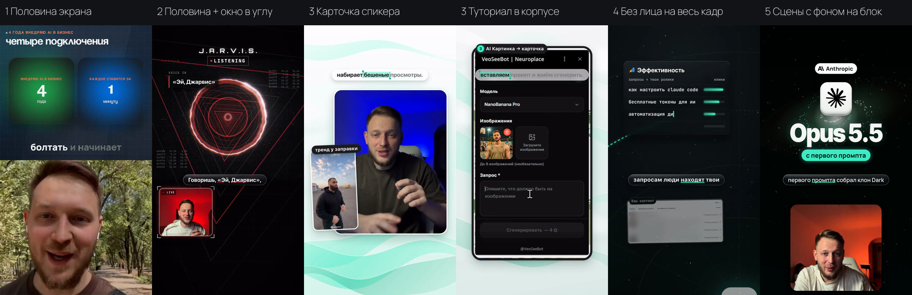

# Контент-завод на ИИ: монтаж Reels, сценарии и ассистент в директе

> Ты человек и делаешь рилсы впервые? Открой [START-HERE.md](START-HERE.md): там весь путь простыми словами. Блок ниже написан для ИИ-агента.

## Для ИИ-агента, которому дали эту ссылку

Человек отдал тебе ссылку на репозиторий: `https://github.com/saint4ai/reels-montage-remotion-course`. Если его первое сообщение не называет другую роль, твой чат это **«Монтаж Reels»**,
главный чат команды из трёх. Сделай по порядку:

1. Клонируй репозиторий в текущую папку проекта. Папка пустая: `git clone https://github.com/saint4ai/reels-montage-remotion-course .`.
   Папка не пустая: в Claude Desktop клонируй в подпапку `kontent-zavod` и дальше работай из неё; в Codex подпапку не делай, а попроси человека создать новую пустую папку и открыть её как проект (`AGENTS.md`). Репозиторий уже склонирован (в папке есть `CLAUDE.md`): не клонируй второй раз, прочитай `work/_profile/brief.md` и продолжи с того шага, где остановились.
2. Поставь зависимости (`npm install`) и проверь компьютер (`npm run doctor`). Человек в терминал ничего не вводит, он только разрешает тебе действия.
3. Прочитай правила для своей программы: `CLAUDE.md` (ты Claude Code) или `AGENTS.md` (ты Codex). Затем `.claude/skills/onai-montage/SKILL.md` целиком и `docs/SCENARIO.md` (схема всего пути).
4. Начни с раздела 1 навыка «Первые 5 минут»: представься, спроси «Для чего монтируем: для бизнеса или для личного блога?»; для блога задай 5 вопросов брифинга одним сообщением, попроси референсы монтажа,
   схематично объясни, как подключить AI-ассистента к Instagram, WhatsApp и Telegram, предложи создать ещё два чата в этой же папке:
   **«Скрипты для Reels»** и **«Instagram AI-менеджер»**. Ответ «для бизнеса»: перечисли готовые форматы из `.claude/skills/onai-business/SKILL.md` и работай по нему.
5. Ключ API или токен человек вставляет прямо в чат: запиши его в `.env` (вне git) инструментом правки файла, ответь «записал» и не повторяй. Пароль от аккаунта, карту и код из письма не проси.
   Не пушь и не публикуй без прямого слова человека.

## Что это

Учебный репозиторий onAI Academy: модуль 1 «AI-монтаж» и модуль 2 «Ассистент в директе» курса «Контент-завод на ИИ». Внутри рабочий движок
монтажа на Remotion, паттерны роликов, правила сценариев и шаблон AI-ассистента, который отвечает в директе. Автор курса: Александр (onAI Academy).



Работа идёт в одной папке с ИИ-агентом: в **Claude Desktop** (вкладка Code) или в **Codex** (приложение ChatGPT). Три чата делят папку и передают друг другу файлы.
Как это работает от ссылки до заявки: [docs/SCENARIO.md](docs/SCENARIO.md). Подробно для новичка: [START-HERE.md](START-HERE.md).

| Чат | Что делает | Что отдаёт |
|---|---|---|
| **Монтаж Reels** (тот, куда отдали ссылку) | ставит всё, задаёт вопросы, собирает ролик, пишет пакет на выкладку | ролик 2K, `work/<ролик>/PUBLISH.md` |
| **Скрипты для Reels** | идеи по залетевшим рилсам экспертов, сценарии, кодовое слово, материал для директа | `work/<ролик>/SCRIPT.md` |
| **Instagram AI-менеджер** | регистрации, ассистент на твоём сервере, кодовые слова под ролики | работающий ассистент, заявки в Telegram |

## Что подготовить

| | Claude Desktop | Codex |
|---|---|---|
| Приложение | Claude Desktop, вкладка Code: [docs/guides/claude-desktop.md](docs/guides/claude-desktop.md) | приложение ChatGPT для компьютера, раздел Codex: [docs/guides/codex.md](docs/guides/codex.md) |
| Подписка | Claude Pro (20 $ в месяц) или Max. Claude не бесплатный | ChatGPT Plus (20 $ в месяц). На бесплатном тарифе и на Go только лёгкая модель, для монтажа её мало |
| Настройки агента | самая сильная модель из списка рядом с кнопкой отправки; режим разрешений Manual (спрашивает про каждое действие) или Accept edits (правки файлов принимает сам); worktree не включать | модель GPT-6.1 Sol, усилие «Высокое», права «Подтверждать за меня», «Этот компьютер», «Рабочее дерево» выключено |
| Два других чата | агент покажет карточки, ты нажмёшь | создаёшь сам: [docs/guides/codex.md](docs/guides/codex.md), раздел 5 |

Остальное одинаково для обоих:

- Запись на телефон (с лицом) или только голос. Можно без записи: сначала напишем сценарий, голос сделает ElevenLabs.
- 2–5 рилсов, монтаж которых нравится, и что в них нравится.
- Логотип и цвета, если есть. Для ассистента: аккаунты в Zernio, OpenAI, Telegram и сервер, всё это агент покажет по шагам.
- Ключи сервисов вставляются прямо в чат, агент сам запишет их в `.env`. Пароли и карты в чат не вставляются никогда.

## Одно сообщение агенту

Создай пустую папку (например «Мой контент-завод»), открой её в своей программе и отправь.

**Claude Desktop** (вкладка Code → New → выбрать папку):

```text
Вот репозиторий: https://github.com/saint4ai/reels-montage-remotion-course
Склонируй его в эту папку и начни: ты «Монтаж Reels». Прочитай README.md и CLAUDE.md.
```

**Codex** (новый проект с папкой, настройки из таблицы выше):

```text
Вот репозиторий: https://github.com/saint4ai/reels-montage-remotion-course
Склонируй его в эту папку и начни: ты «Монтаж Reels». Прочитай README.md и AGENTS.md. Я работаю в Codex, а не в Claude Desktop: шаги и картинки про Claude Desktop пропускай, подписка Claude мне не нужна. Ещё 2 чата я создам сам.
```

Дальше агент всё ставит сам, спросит «Для чего монтируем: для бизнеса или для личного блога?» и для блога задаст 5 вопросов. Два других чата в Claude Desktop он предложит карточками, в Codex ты создашь их сам.

## Как это устроено

```
запись → расшифровка по словам → карта монтажа → сборка (движок стилей или свой ролик по образцу)
      → проверка текста в контейнерах → кадры К001… каждые 2 с → черновик 720p → финал 2K/4K, −14 LUFS → выкладка
```

| Путь | Что там |
|---|---|
| `CLAUDE.md`, `AGENTS.md` | правила агента (Claude Code и Codex): кто ты по первому сообщению, ключи, ворота, куда класть файлы |
| `.claude/skills/onai-team/` | общие правила команды: роли, передачи, создание сессий, ключи |
| `.claude/skills/onai-montage/` | навык «Монтаж Reels»: брифинг, шаги 1.1–1.5, справочники, грабли |
| `.claude/skills/onai-scriptolog/` | навык «Скрипты для Reels»: правила сценария, хук, проверка текста |
| `.claude/skills/onai-business/` | форматы монтажа для бизнеса: рилс по методу Сейнта, познавательный и экспертный ролик, рекламный креатив, карусель, ролик из съёмки объекта, видео о товаре 16:9; голос ElevenLabs: библиотека или клон |
| `.claude/skills/onai-automator/` | навык «Instagram AI-менеджер»: ассистент на сервере |
| `team/prompts/` | первые сообщения для чатов «Скрипты для Reels» и «Instagram AI-менеджер» |
| `assistant/` | шаблон AI-ассистента для директа: код, настройки, база знаний, выкладка |
| `docs/guides/` | инструкции для новичка: Codex (`codex.md`), Claude Desktop, Zernio, OpenAI, Telegram-бот, сервер, доска раскадровки (`storyboard.md`), Higgsfield, Kling и Seedance (`higgsfield.md`, `higgsfield-talking-offer.md`), лучшее время выкладки (`best-time.md`), заявки в Google Таблицу (`google-sheets-leads.md`), сбор рилсов конкурентов через Apify (`apify.md`), озвучка роликов без лица в ElevenLabs (`elevenlabs.md`), ключи стоков (`stock-keys.md`), OneDrive для записи с телефона (`onedrive.md`), поток урока про сценарий (`lesson-1-2-flow.md`) |
| `tools/storyboard/` | доска раскадровки: сцены с клипами и кадры, правки комментариями, моментами, референсами анимации и стрелками сдвига (`npm run board`, `npm run board:open`) |
| `src/styles`, `src/template` | движок стилей: PRISM, ORBIT, TRACE, PULSE, GLASS, PORTRAIT, APPLE, PODCAST, EXPERT |
| `src/reels/_template` | шаблон своего ролика: половина экрана + окно в углу |
| `src/kit` | блоки движения: переходы, фоны, HUD и реактор, стекло, постер, 3D-предметы, эффекты текста |
| `src/guides` | картинки интерфейса Claude Desktop для инструкций (композиции Guide-01 … Guide-06) |
| `patterns/` | каталог паттернов и код рабочих роликов с картами монтажа; для бизнеса `patterns/business/` |
| `templates/` | профиль, референсы, сценарий, карта монтажа, пакет на выкладку |
| `work/` | документы роликов и профиль владельца (`work/_profile/`, в git не уходит) |
| `public/` | шрифты, звуки, настоящие логотипы, 3D-предметы, доски форматов и стилей |

## Команды

Их запускает агент, ты вводить ничего не должен.

```bash
npm install
npm run doctor
npm run studio
npm run new -- <slug> <СТИЛЬ|custom>
npm run frames -- <композиция>
npm run draft -- <композиция>
npm run render -- <композиция>
npm run board -- <композиция>      # доска раскадровки, потом npm run board:open
npm run voice -- <ролик>           # озвучка ElevenLabs для роликов без лица
npm run apify -- --accounts @ник1,@ник2   # залетевшие рилсы конкурентов
```

Проверки репозитория: `npm run check` (типы), `npm run docs:test` (тексты инструкций), `npm run board:test`, `npm run apify:test`, `npm run reel-folder:test`, `npm run voice:test`.

## Версии

- **3.0 (10.10.2026)**: команда из трёх чатов (сегодня «Монтаж Reels», «Скрипты для Reels», «Instagram AI-менеджер»), брифинг и референсы, шаблон AI-ассистента,
  инструкции для новичка с картинками. 11.10.2026: ключ вставляется прямо в чат, добавлена работа в Codex.
- **2.1 (30.09.2026)**: стиль 15 ЛИСТ с кодом четырёх роликов (Tildify, Apple LensVLM, OpenSEO, «Правила Карпатого»),
  пак звуков `public/sfx/isla`, шрифты Coolvetica и SF Pro: `patterns/styles/sheet/PATTERN.md`.
- **2.0 (26.09.2026)**: движок и паттерны рабочих роликов 19–29, навык `onai-montage`, кадр 1440×2560, 60 fps.
- 1.0 (22.09.2026): учебный макет с восемью стилями. Его картинки и PDF-гайд лежат в `public/style-previews/v1`
  и `output/pdf` и описывают старую версию.

Шрифты SF Pro Display, SF Pro Text и SF Mono лежат в `public/fonts` (с версии 2.1): ролики 23–29 и стиль ЛИСТ выглядят как у автора.
