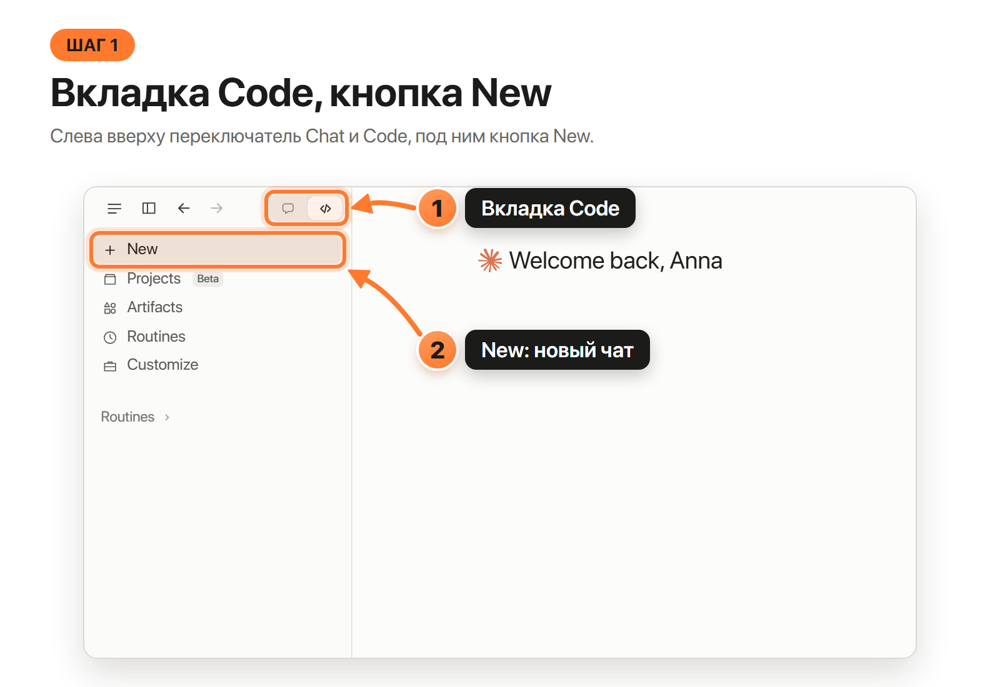
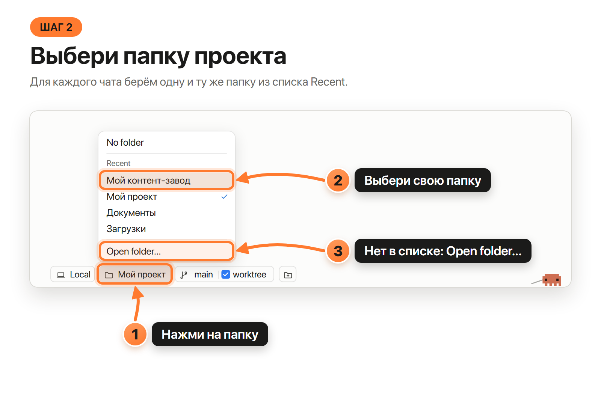
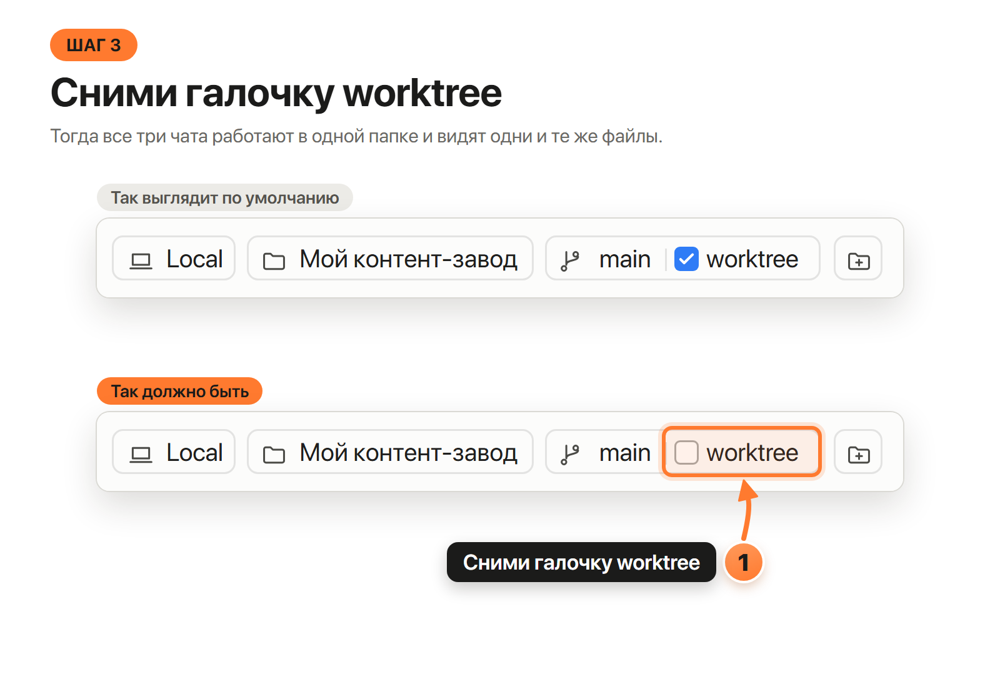
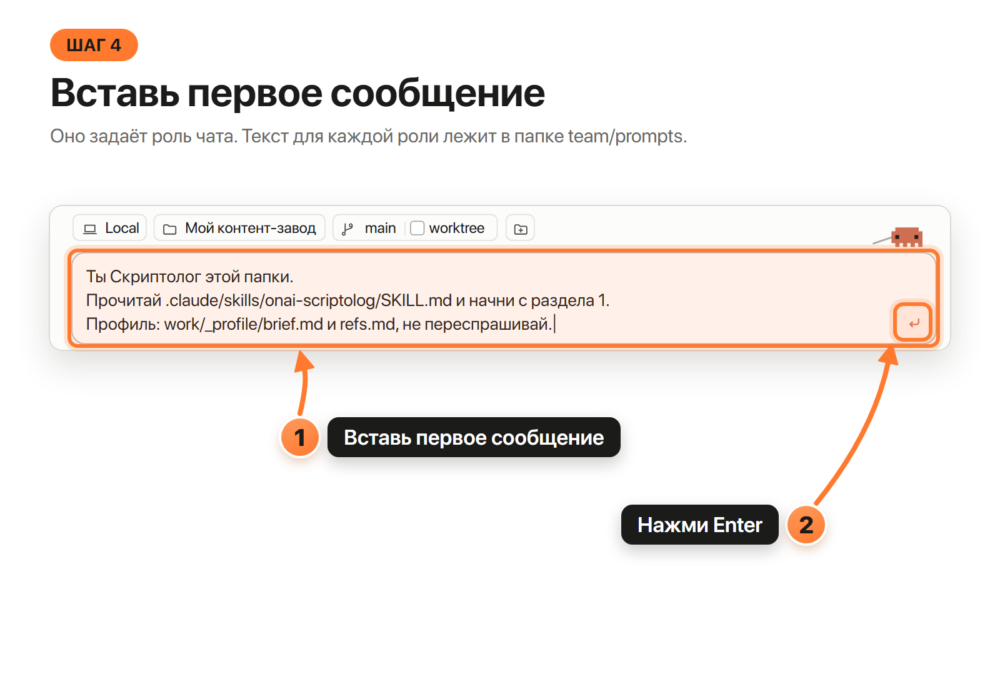
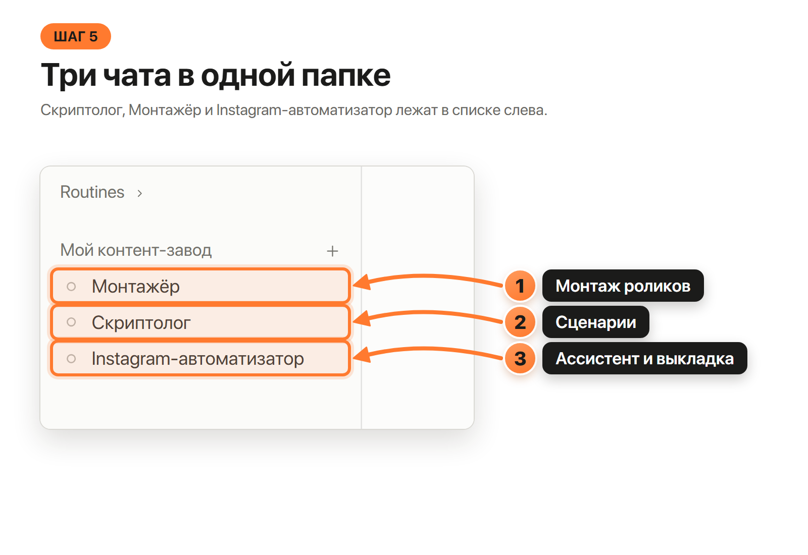
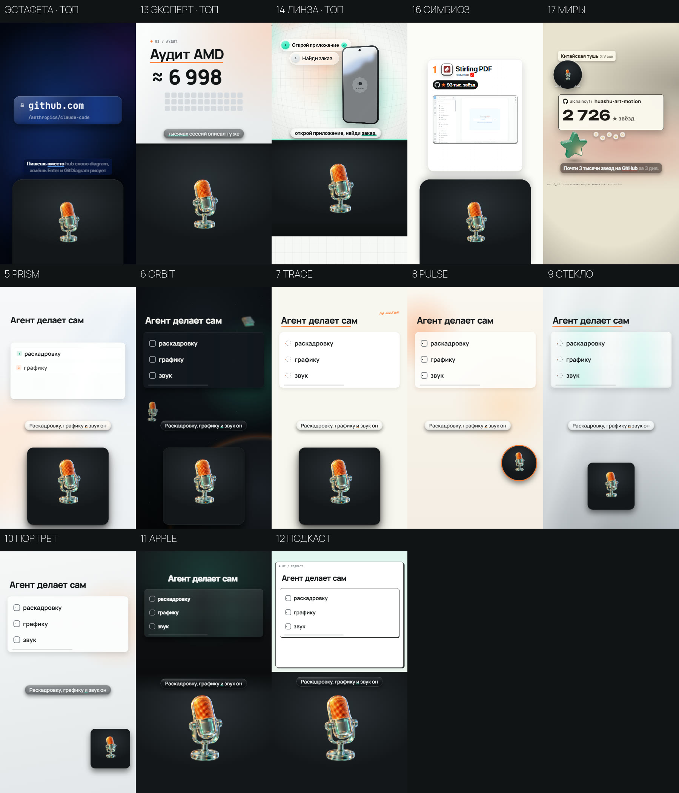
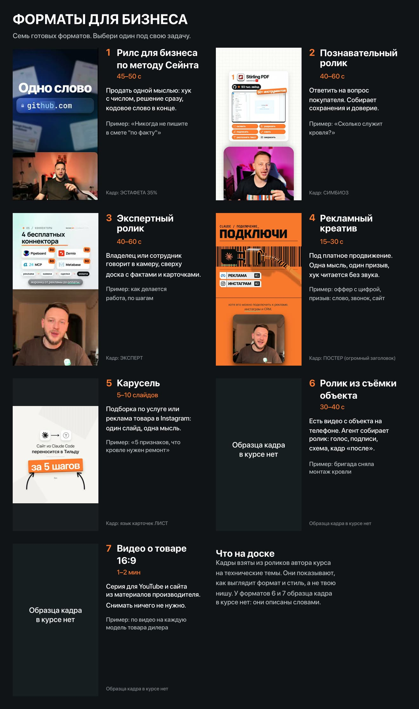

# Начни здесь

Эта страница для тех, кто делает рилсы впервые и не любит терминал. Вводить команды тебе не придётся: всё ставит и запускает ИИ-агент. Ты разрешаешь ему действия, отвечаешь на вопросы, иногда вводишь пароль Mac в системном окне и смотришь результат. Как устроен весь путь от ссылки до заявки: [docs/SCENARIO.md](docs/SCENARIO.md).

## 1. Выбери, где работаешь, и поставь программу

Подойдёт любой из двух вариантов. Платить за обе подписки не нужно, работа в них одинаковая.

| | Claude Desktop | Codex |
|---|---|---|
| Что это | приложение Claude для компьютера, вкладка **Code** | приложение ChatGPT для компьютера, раздел **Codex** |
| Подписка | Claude Pro или Max, от 20 $ в месяц (Claude не бесплатный) | ChatGPT Plus, 20 $ в месяц (на бесплатном тарифе и на Go для монтажа не хватит) |
| Как поставить и настроить | [docs/guides/claude-desktop.md](docs/guides/claude-desktop.md) | [docs/guides/codex.md](docs/guides/codex.md) |

### Что поставится само

Заранее ставить ничего не нужно. Агент сам установит всё для монтажа: Node.js, ffmpeg, Git и Python. Твоя часть только в системных окнах:

- Windows: окно «Разрешить этому приложению вносить изменения?». Нажми «Да».
- Mac: агент откроет Терминал, и тот попросит пароль. Это твой пароль входа в Mac, агент его не видит. Символы при вводе не показываются, это нормально: вводи вслепую и нажми Enter.
- Mac: окно «инструменты командной строки». Нажми «Установить», это займёт несколько минут.

Пароль от Mac агенту в чат не вставляй никогда: он нужен только в Терминале или системном окне.

Курс обновляется сам: в каждом новом чате агент проверяет обновления на GitHub. Можно и попросить: «Обнови курс».

Работаешь в Codex: шаги и картинки про Claude Desktop ниже пропускай, твой путь в [docs/guides/codex.md](docs/guides/codex.md) (там же первое сообщение, настройки модели и права).

## 2. Как открыть папку и отдать ссылку (Claude Desktop)

1. Создай пустую папку, например «Мой контент-завод».
2. В Claude Desktop открой вкладку **Code** и нажми **+ New session**. Выбери эту папку. Подробно, с картинками: [docs/guides/claude-desktop-sessions.md](docs/guides/claude-desktop-sessions.md).
3. Отправь агенту одно сообщение:

```text
Вот репозиторий: https://github.com/saint4ai/reels-montage-remotion-course
Склонируй его в эту папку и начни: ты «Монтаж Reels». Прочитай README.md и CLAUDE.md.
```





Codex: то же самое, только сообщение другое и настройки модели, усилия и прав ты задаёшь до отправки. Всё это в [docs/guides/codex.md](docs/guides/codex.md), шаги 2–4.

## 3. Что разрешать агенту

Агент будет спрашивать разрешения. Сначала это выглядит непривычно, но правило простое.

- **Разрешай:** ставить программы (Node.js, ffmpeg, Git), скачивать файлы с github.com, создавать и менять файлы в папке проекта, запускать проверки и рендер. Windows может спросить «Разрешить этому приложению вносить изменения?»: нажми «Да».
- **Не разрешай и напиши в чат курса:** просит пароль от аккаунта, данные карты или код из письма; предлагает удалить файлы вне папки проекта; хочет что-то выложить или оплатить, пока ты не сказал «выкладывай».
- Исключение: пароль Mac в окне терминала при установке программ (раздел 1). Его вводишь ты сам, агенту его не пиши.
- Не понял, что просит агент: напиши «Объясни простыми словами, что ты сейчас делаешь и зачем».

## 4. Три чата и кто что делает

Чат, куда ты отдал ссылку, становится **«Монтаж Reels»**. Он ставит всё, спросит «Для чего монтируем: для бизнеса или для личного блога?», задаст 5 вопросов (для блога), попросит референсы и предложит создать ещё два чата в той же папке.

| Чат | Что делает |
|---|---|
| **Монтаж Reels** (главный) | ставит всё, спрашивает про тебя и твой блог, собирает ролик, показывает кадры, готовит пакет на выкладку |
| **Скрипты для Reels** | находит идеи по залетевшим рилсам экспертов, пишет сценарий, придумывает кодовое слово и материал для директа |
| **Instagram AI-менеджер** | ведёт по регистрациям в сервисах, ставит на твой сервер ассистента, который отвечает в директе, и выкладывает ролики |

Claude Desktop: два других чата «Монтаж Reels» покажет карточками, ты жмёшь на каждую, и чат открывается в той же папке. Если карточек нет, иди по картинкам из
[docs/guides/claude-desktop-sessions.md](docs/guides/claude-desktop-sessions.md): новый чат в той же папке, галочка worktree снята, первое сообщение вставлено.
Codex: карточек нет, чаты создаёшь сам по [docs/guides/codex.md](docs/guides/codex.md), шаг 5: новый чат, тот же проект, «Рабочее дерево» выключено, первое сообщение из `team/prompts/`.







Чаты общаются через файлы в папке проекта. Закончил один чат, напиши в следующий: «готово, смотри work/<название ролика>/…».

## 5. Что подготовить

- Запись на телефон (с лицом) или только голос. Можно без записи: «Скрипты для Reels» сначала напишут сценарий, голос для ролика без лица сделает ElevenLabs.
- 2–5 рилсов, монтаж которых нравится, и что в них цепляет. Ссылки или файлы.
- Логотип и цвета, если есть. Скриншоты или ссылка на продукт, о котором ролик.
- Для ассистента в директе: аккаунты в Zernio, OpenAI, Telegram и сервер. Инструкции для новичка: [docs/guides/zernio.md](docs/guides/zernio.md),
  [docs/guides/openai.md](docs/guides/openai.md), [docs/guides/telegram-bot.md](docs/guides/telegram-bot.md), [docs/guides/server-vps.md](docs/guides/server-vps.md).
  Не хочешь делать по инструкции: в Claude Desktop агент сделает за тебя через свой браузер, ты только входишь в аккаунты и платишь сам. В Codex браузера для регистраций может не быть: агент ведёт тебя по инструкциям шаг за шагом, называя страницу и кнопку.

## 6. Ключи: просто вставь в чат

Ключ это длинная строка из панели сервиса (Zernio, OpenAI, токен Telegram-бота, ElevenLabs, Apify). Файл создавать не нужно:

1. Скопируй ключ в панели сервиса.
2. Вставь его в чат: «Мой ключ Zernio: <ключ>. Запиши его в .env и нигде не повторяй».
3. Агент сам запишет его в файл `.env` (в git он не попадает), ответит «записал» и больше не покажет.

Пароль от аккаунта, данные банковской карты и код из письма в чат **не вставляй никогда**: вход и оплату ты делаешь сам в окне браузера. Ключ случайно попал на скриншот или в сторис: удали его в сервисе и создай новый. Подробнее: [docs/guides/claude-desktop.md](docs/guides/claude-desktop.md), раздел «Как отдать ключ агенту».

## 7. Как идёт работа

| Шаг | Что делает агент | Что делаешь ты |
|---|---|---|
| 1.1 Рабочее место | ставит зависимости, проверяет компьютер, спрашивает, для чего монтируем (бизнес или блог), задаёт 5 вопросов, просит референсы | отвечаешь, присылаешь референсы, создаёшь два других чата |
| 1.2 Идея и сценарий | «Скрипты для Reels» собирают идеи и пишут текст так, чтобы ролик не пролистывали в первые 3 секунды | утверждаешь текст, записываешь видео или голос |
| 1.3 Формат и стиль | показывает доски форматов и стилей, советует один | выбираешь |
| 1.4 Сборка | расшифровка, карта монтажа, сборка, проверки, кадры К001… и доска раскадровки | правишь сцены и кадры на доске (комментарий, референс анимации, стрелка сдвига), говоришь «ок» по кадрам и черновику |
| 1.5 Серия и выкладка | пакет на выкладку, подпись, текст директа, замер статистики | говоришь «выкладывай», когда готов |




Для бизнеса агент покажет ещё доску из семи форматов:



Каждый формат и стиль одной-двумя фразами, с примерами задач: [docs/guides/patterns.md](docs/guides/patterns.md).

## 8. Как давать правки

Правки ты даёшь на **доске раскадровки**: это страница на твоём компьютере. Сверху на ней сцены (куски ролика по несколько секунд с видео, видно, как работает анимация), ниже все кадры К001, К002… Агент соберёт её сам и скажет адрес. На любой сцене ты можешь посмотреть клип, написать комментарий («здесь неправильный текст», «здесь не нравится анимация»), отметить момент клипа и приложить референс нужной анимации (файл или ссылку и «что взять»: движение, шрифт, переход, темп). На любом кадре ты можешь:

- поставить оценку и написать комментарий («К003: заголовок мельче, лицо обрезано по голове»);
- приложить референс: скриншот или видео нужной анимации, либо ссылку;
- передвинуть объект стрелкой: нажать «↔ Сдвиг объектов» под кадром, протянуть мышкой от объекта к новому месту, подписать, что двигаем, и при желании выбрать «крупнее» или «мельче».

Потом напиши агенту «оставил комментарии на доске». Он прочитает всё (стрелки в пикселях кадра), исправит и ответит в тех же ветках. Подробно: [docs/guides/storyboard.md](docs/guides/storyboard.md). Финальный рендер только после твоего «ок» по кадрам и черновику 720p. Пока идёт рендер, агент ничего тяжёлого не запускает: компьютер может работать медленнее.

## 9. Результат

Финал в 2K (1440×2560, 60 кадров в секунду), 4K по просьбе. Громкость выровнена. Рядом пакет на выкладку: подпись и заголовок для YouTube. Когда ассистент уже работает, в нём
ещё кодовое слово, текст директа и ответы на частые вопросы; до этого ролики идут без кодового слова и ты выкладываешь их сам. Публикация только по твоему слову.

## 10. Если что-то непонятно

Спроси агента простыми словами: «Что сейчас происходит и что мне нужно сделать?» Он объяснит шаг и скажет, нажимать что-то самому или он сделает сам.
Закрыл чат случайно или вернулся через день: открой новый чат в той же папке (в Codex в том же проекте) и вставь текст для своей программы. Вся работа лежит в файлах папки, ничего не потеряно.

Для «Монтаж Reels» в Claude Desktop:

```text
Ты «Монтаж Reels». Репозиторий уже склонирован. Прочитай README.md и CLAUDE.md, посмотри work/_profile/brief.md и скажи, на каком шаге мы остановились.
```

Для «Монтаж Reels» в Codex:

```text
Ты «Монтаж Reels». Репозиторий уже склонирован. Прочитай README.md и AGENTS.md. Я работаю в Codex, а не в Claude Desktop: шаги и картинки про Claude Desktop пропускай, подписка Claude мне не нужна. Посмотри work/_profile/brief.md и скажи, на каком шаге мы остановились. Ещё 2 чата у меня уже есть.
```

Для двух других чатов вставь первое сообщение из `team/prompts/`. Если агент клонировал репозиторий в подпапку `kontent-zavod`, в Codex открой проект из неё и веди в нём все три чата (см. [docs/guides/codex.md](docs/guides/codex.md), шаг 5).
Подключение сервисов к Claude (Connectors) тоже с картинкой: [docs/guides/claude-desktop-sessions.md](docs/guides/claude-desktop-sessions.md), шаг 6.
