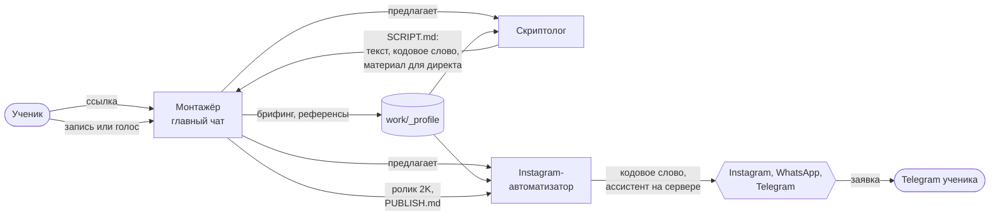

# Как работает контент-завод: сценарий от ссылки до заявки

Версия 3, черновик на утверждение (10.10.2026). Этот файл описывает путь нового ученика: что он делает руками, что делают
агенты и в каком чате. По нему собираются раздаточные материалы к урокам и автотесты репозитория.

## Схема одной картинкой

Три чата Claude Code в одной папке проекта:

| Чат | Что делает | Что отдаёт |
|---|---|---|
| **Монтажёр** (главный) | ставит всё, брифинг, референсы, монтаж по шагам, финал | ролик 2K, `work/<ролик>/PUBLISH.md` |
| **Скриптолог** | идеи по залетевшим рилсам экспертов, сценарии, кодовое слово, материал для директа | `work/<ролик>/SCRIPT.md` |
| **Instagram-автоматизатор** | регистрации, ассистент на сервере ученика, кодовые слова под ролики | работающий ассистент, заявки в Telegram |

## Что ученик делает руками (всё остальное делают агенты)

1. Ставит Claude Desktop и оплачивает подписку Claude Pro или Max.
2. Создаёт пустую папку, например «Мой контент-завод», открывает её во вкладке Code и отдаёт ссылку.
3. Отвечает на вопросы и присылает референсы.
4. Жмёт карточки «Скриптолог» и «Instagram-автоматизатор» (или создаёт два чата по картинкам).
5. Записывает видео или голос по готовому тексту.
6. Одобряет кадры и черновик, даёт правки по номерам кадров.
7. Для ассистента: регистрируется в Zernio, OpenAI, Telegram и у провайдера сервера, пополняет баланс.
   Можно не по инструкции: войти в аккаунты во встроенном браузере Claude, остальные шаги пройдёт агент.
   Пароль, оплату и копирование ключа ученик всегда делает сам. Ключи не вставляются в чат.

## Шаг за шагом

### Шаг 0. Ссылка (урок 1.1 «Рабочее место»)
Ученик пишет в новом чате: «Вот репозиторий: <ссылка>». Монтажёр клонирует его в папку, ставит зависимости, проверяет
компьютер (`npm run doctor`) и чинит, что не так. Ученик в терминал ничего не вводит, только разрешает действия.

### Шаг 1. Знакомство и брифинг (урок 1.1)
Монтажёр представляется, показывает схему трёх чатов и задаёт не больше 5 вопросов одним сообщением:
1. Чем ты занимаешься и кому продаёшь?
2. Зачем тебе рилсы: заявки, продажи, личный бренд, клиенты на SMM?
3. Ты в кадре или без лица (свой голос, голова-рассказчик, только моушн)? Есть готовая запись?
4. Какой монтаж нравится? (доска стилей картинкой)
5. Куда сейчас приходят клиенты: директ Instagram, WhatsApp, Telegram? Нужен ассистент, который отвечает за тебя?

Ответы сохраняются в `work/_profile/brief.md`: их читают все три чата и больше не переспрашивают.

### Шаг 2. Референсы (урок 1.3 «Выбор стиля»)
Монтажёр просит 2–5 рилсов, монтаж которых нравится (ссылки или файлы), и что именно в них цепляет. Разбирает каждый:
хук, формат (где человек, сколько места у графики), стиль, темп. Итог в `work/_profile/refs.md` и совет: формат и стиль
из библиотеки, ближайшие к референсам. Новичку первым советуются три стиля, которые у автора курса набирают больше
всего просмотров: ЭСТАФЕТА 35%, ЭКСПЕРТ, ЛИНЗА.

### Шаг 3. Команда (урок 1.1, урок 2.5 «Контент-завод целиком»)
Монтажёр объясняет схему ассистента в директе (кодовое слово → ответ под комментарием и материал в директ → ответы на
вопросы → заявка в Telegram) и что для неё понадобится. Затем предлагает два чата в той же папке:
- в Claude Desktop агент сам показывает две карточки «Скриптолог» и «Instagram-автоматизатор», ученик жмёт;
- если карточек нет, инструкция с картинками: `docs/guides/claude-desktop-sessions.md`.

### Шаг 4. Идея и сценарий (урок 1.2 «Сценарий и 3 секунды», чат Скриптолог)
Скриптолог читает профиль, просит ники экспертов, на которых ученик подписан, собирает их залетевшие рилсы из открытых
профилей (браузер Claude или сервис Apify) и предлагает идеи с самыми большими просмотрами. Чужое видео не копируется:
берётся идея, пишется свой текст. Сценарий 45–50 секунд по правилам: хук с видимым результатом в первой фразе, сразу
решение, одно число-доказательство, мысль для пересылки, кодовое слово в конце. Факты проверяются по первоисточнику.
Сдача: название и весь текст одним блоком для суфлёра, плюс материал для директа. Всё в `work/<ролик>/SCRIPT.md`.

### Шаг 5. Запись
Ученик записывает видео на телефон или голос по тексту (голос можно отдать нейросети ElevenLabs) и кладёт файл в папку
ролика. Пишет монтажёру: «Запись готова».

### Шаг 6. Монтаж (урок 1.4 «Сборка ролика», чат Монтажёр)
Расшифровка по словам → карта монтажа (что на экране каждую секунду, где графика, переход, звук) → сборка → проверка
текста в контейнерах → лист кадров К001… каждые 2 секунды. Ученик даёт правки по номерам («К006: вместо иконки настоящий
скриншот»). Черновик 720p → «ок» → финал 2K, громкость −14 LUFS. Монтажёр пишет `work/<ролик>/PUBLISH.md`: подпись,
кодовое слово, текст для директа.

### Шаг 7. Ассистент (урок 2.2 «ИИ-менеджер в WhatsApp и Instagram», чат Instagram-автоматизатор)
1. Регистрации по `docs/guides/`: Zernio (к нему подключаются Instagram, по желанию WhatsApp и Telegram), ключ OpenAI,
   бот Telegram для заявок, сервер VPS. Или вход во встроенном браузере, дальше агент сам.
2. Брифинг бизнеса для промпта (если монтажёр уже спросил, не повторяет): что можно называть, ссылки, как записаться,
   тон, куда слать заявки.
3. Агент заполняет базу знаний и промпт, показывает ответы на 10 типичных вопросов, ученик одобряет.
4. Агент сам ставит ассистента на сервер, подключает вебхук Zernio, проверяет здоровье.
5. Живая проверка: ученик со второго аккаунта пишет комментарий с кодовым словом и вопрос в директ.

### Шаг 8. Публикация и серия (урок 1.5 «Серия роликов»)
Автоматизатор добавляет кодовое слово ролика в ассистента. Ролик выкладывается через Zernio (сначала пробным, к
подписчикам, если залетел) или вручную, только по слову ученика. Через 24 часа, 72 часа и 7 дней агент смотрит
статистику и переносит вывод в следующий ролик. Цель: ролик каждый день, 30 в месяц.

## Ворота: где агент останавливается и ждёт ученика

| Где | Что показывает агент | Чего ждёт |
|---|---|---|
| Брифинг | 5 вопросов | ответы |
| Референсы | разбор и совет по стилю | выбор формата и стиля |
| Сценарий | текст для суфлёра | «ок» или правки |
| Кадры | лист К001… | правки по номерам или «ок» |
| Черновик | 720p | «ок» |
| Ассистент | ответы на 10 вопросов | «ок» перед выкладкой на сервер |
| Публикация | файл, подпись, слово | «выкладывай» |

## Уроки курса и шаги

| Урок | Шаги |
|---|---|
| 1.1 Рабочее место | 0, 1, 3 |
| 1.2 Сценарий и 3 секунды | 4 |
| 1.3 Выбор стиля | 2 |
| 1.4 Сборка ролика | 5, 6 |
| 1.5 Серия роликов | 8 |
| 2.2 ИИ-менеджер в WhatsApp и Instagram | 7 |
| 2.5 Контент-завод целиком | все три чата вместе, шаги 3–8 по кругу |
