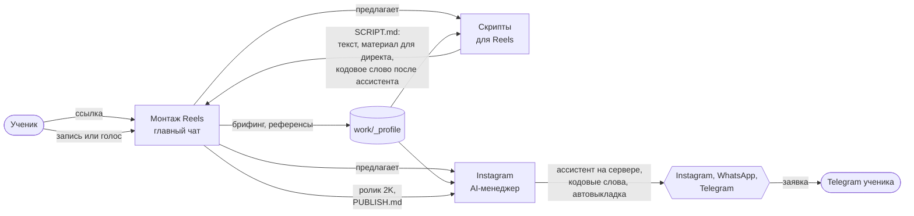

# Как работает контент-завод: сценарий от ссылки до заявки

Версия 3 (обновлено 11.10.2026: названия чатов, ключ прямо в чат, ученики в Codex). Этот файл описывает путь нового ученика: что он делает руками, что делают
агенты и в каком чате. По нему собираются раздаточные материалы к урокам и автотесты репозитория.

## Схема одной картинкой

Три чата в одной папке проекта (в Claude Desktop на вкладке Code или в Codex в приложении ChatGPT, правила одни):

| Чат | Что делает | Что отдаёт |
|---|---|---|
| **Монтаж Reels** (главный) | ставит всё, брифинг, референсы, монтаж по шагам, финал | ролик 2K, `work/<ролик>/PUBLISH.md` |
| **Скрипты для Reels** | идеи по залетевшим рилсам экспертов, сценарии; кодовое слово и материал для директа, когда ассистент работает | `work/<ролик>/SCRIPT.md` |
| **Instagram AI-менеджер** | регистрации, ассистент на сервере ученика, кодовые слова под ролики, автовыкладка | работающий ассистент, заявки в Telegram |

## Правило про кодовое слово: только после ассистента

Урок 1.5 (публикация) идёт раньше урока 2.2 (ассистент). Кодовое слово бесполезно, пока некому отвечать на комментарий, поэтому:

- **Пока ассистент не работает** (в `work/_profile/brief.md` нет строки «ассистент: работает с <дата>»): «Скрипты для Reels» пишут концовку без кодового слова и без «пришлю инструкцию». Последняя фраза сильная или один простой призыв: сохранить, переслать, подписаться. Материал для директа не пишется. Ролики ученик выкладывает сам, `PUBLISH.md` без кодового слова и без текста директа.
- **Когда ассистент работает**: «Instagram AI-менеджер» прошёл живую проверку вдвоём с учеником (шаг 7, все шесть пунктов) и записал в `work/_profile/brief.md` строку «ассистент: работает с <дата>». С этого дня «Скрипты для Reels» пишут концовки с кодовым словом и материалом для директа, «Монтаж Reels» кладёт слово и директ в `PUBLISH.md`, «Instagram AI-менеджер» заводит слово и выкладывает ролики через Zernio (шаги 7 и 8).
- Старые ролики без слова не переделываются. Ролик с кодовым словом без работающего ассистента не выкладывается: человек напишет слово и не получит ответа.

## Что ученик делает руками (всё остальное делают агенты)

1. Выбирает, где работает, и оплачивает подписку: Claude Desktop и Claude Pro или Max (Claude не бесплатный) **или** Codex в приложении ChatGPT и ChatGPT Plus, 20 $ в месяц (`docs/guides/codex.md`: GPT-6.1 Sol, усилие «Высокое», права «Подтверждать за меня»).
2. Создаёт пустую папку, например «Мой контент-завод», открывает её (в Claude Desktop во вкладке Code, в Codex как проект) и отдаёт ссылку.
3. Отвечает на вопросы и присылает референсы.
4. В Claude Desktop жмёт карточки «Скрипты для Reels» и «Instagram AI-менеджер» (или создаёт два чата по картинкам). В Codex карточек нет: два чата он создаёт сам по шагам `docs/guides/codex.md`, раздел 5.
5. Записывает видео или голос по готовому тексту. Ролик без лица: вставляет в чат ключ ElevenLabs, выбирает голос и слушает озвучку (`docs/guides/elevenlabs.md`).
6. Одобряет кадры и черновик. Правки даёт на доске раскадровки: по сценам комментарий с моментом и референс анимации, по кадрам комментарий и стрелка сдвига объекта (`docs/guides/storyboard.md`).
7. Для ассистента: регистрируется в Zernio, OpenAI, Telegram и у провайдера сервера, пополняет баланс.
   Можно не по инструкции: в Claude Desktop войти в аккаунты во встроенном браузере агента, остальные шаги пройдёт он. В Codex браузера для регистраций может не быть, агент ведёт по инструкциям шаг за шагом.
   Пароль, оплату и код из письма ученик вводит сам. Ключ (API-ключ, токен бота, адрес Google Таблицы, ключ ElevenLabs, Apify, стоков) он копирует в панели сервиса и
   **вставляет прямо в чат** (решение владельца курса, 11.10.2026): агент сам записывает его в `.env` (ключи ассистента в `assistant/.env`), отвечает «записал» и больше не показывает.
   Файл в «Загрузках» создавать не нужно. Ключи для сервера агент переносит на сервер сам. Ключ засветился публично (скриншот, сторис): ученик удаляет его в сервисе и создаёт новый.
   Пароль от аккаунта и данные карты в чат не вставляются никогда.

## Шаг за шагом

### Шаг 0. Ссылка (урок 1.1 «Рабочее место»)
Ученик пишет в новом чате: «Вот репозиторий: <ссылка>». «Монтаж Reels» клонирует его в папку, ставит зависимости, проверяет
компьютер (`npm run doctor`) и чинит, что не так. Ученик не вводит команды в терминал: он разрешает действия и вводит пароль Mac там, где его попросит установка.

### Шаг 1. Знакомство и брифинг (урок 1.1)
«Монтаж Reels» представляется, показывает схему трёх чатов и первым спрашивает: «Для чего монтируем: для бизнеса или для личного блога?».

- **Для бизнеса:** агент перечисляет готовые форматы (рилс по методу Сейнта, познавательный и экспертный ролик, рекламный креатив, карусель, ролик из съёмки объекта, видео о товаре 16:9), спрашивает, какой нужен и какой голос (клон, например сотрудника или менеджера, или библиотека ElevenLabs), просит прислать нарезки своих видео и дальше сам режет и собирает выбранный формат: `.claude/skills/onai-business/SKILL.md` и `patterns/business/README.md`.
- **Для личного блога:** дальше по этому сценарию без изменений.

Брифинг блога, не больше 5 вопросов одним сообщением:
1. Чем ты занимаешься и кому продаёшь?
2. Зачем тебе рилсы: заявки, продажи, личный бренд, клиенты на SMM?
3. Ты в кадре или без лица (свой голос, голова-рассказчик, только моушн)? Есть готовая запись?
4. Какой монтаж нравится? (доску стилей агент открывает в отдельном окне и перечисляет названия стилей)
5. Куда сейчас приходят клиенты: директ Instagram, WhatsApp, Telegram? Нужен ассистент, который отвечает за тебя?

Ответы сохраняются в `work/_profile/brief.md`: их читают все три чата и больше не переспрашивают.

### Шаг 2. Референсы (урок 1.3 «Выбор стиля»)
«Монтаж Reels» просит 2–5 рилсов, монтаж которых нравится (ссылки или файлы), и что именно в них цепляет. Разбирает каждый:
хук, формат (где человек, сколько места у графики), стиль, темп. Итог в `work/_profile/refs.md` и совет: формат и стиль
из библиотеки, ближайшие к референсам. Новичку первым советуются три стиля, которые у автора курса набирают больше
всего просмотров: ЭСТАФЕТА 35%, ЭКСПЕРТ, ЛИНЗА.

### Шаг 3. Команда (урок 1.1, урок 2.5 «Контент-завод целиком»)
«Монтаж Reels» объясняет схему ассистента в директе (кодовое слово → ответ под комментарием и материал в директ → ответы на
вопросы → заявка в Telegram) и что для неё понадобится. Затем предлагает два чата в той же папке:
- в Claude Desktop агент сам показывает две карточки «Скрипты для Reels» и «Instagram AI-менеджер», ученик жмёт;
- если карточек нет, инструкция с картинками: `docs/guides/claude-desktop-sessions.md`;
- в Codex карточек нет, ученик создаёт чаты по шагам `docs/guides/codex.md`, раздел 5, первым сообщением вставляя текст из `team/prompts/`.

### Шаг 4. Идея и сценарий (урок 1.2 «Сценарий и 3 секунды», чат «Скрипты для Reels»)
«Скрипты для Reels» читают профиль, просит ники экспертов, на которых ученик подписан, собирает их залетевшие рилсы из открытых
профилей (браузер Claude или сервис Apify) и предлагает идеи с самыми большими просмотрами. Чужое видео не копируется:
берётся идея, пишется свой текст. Сценарий 45–50 секунд по правилам: хук с видимым результатом в первой фразе, сразу
решение, одно число-доказательство, мысль для пересылки. Концовка зависит от режима: пока ассистент не работает, это сильная последняя фраза или призыв сохранить, переслать, подписаться; когда работает, кодовое слово («Напиши «СЛОВО», пришлю инструкцию, как …»). Факты проверяются по первоисточнику.
Сдача: название и весь текст одним блоком для суфлёра; материал для директа добавляется, когда ассистент работает. Всё в `work/<ролик>/SCRIPT.md`.

### Шаг 5. Запись
Ученик записывает видео на телефон или голос по тексту и кладёт файл в папку ролика. Пишет в чат «Монтаж Reels»: «Запись готова».

Ролик без лица («только графика» или «голова-рассказчик») записи не требует. «Монтаж Reels» сам озвучивает утверждённый текст голосом ElevenLabs
(`npm run voice -- <ролик>`, гайд для ученика `docs/guides/elevenlabs.md`):
1. Ученик регистрируется в ElevenLabs (для роликов, на которых он зарабатывает, нужен платный тариф от 6 $ в месяц), создаёт ключ и вставляет его в чат «Монтаж Reels». Ключ уходит в `.env`.
2. Ученик выбирает голос: агент показывает список или ученик берёт ID в библиотеке голосов на сайте. Выбор записывается в `work/_profile/brief.md`.
3. Агент озвучивает сценарий по фразам и получает `public/work/<ролик>/voice.wav` и слова с временем `work/<ролик>/words.json`. Расшифровка не нужна.
4. Агент проверяет озвучку распознаванием и показывает расхождения (числа, названия). Ученик слушает файл, плохие фразы озвучиваются заново, потом он пишет «озвучка принята».

### Шаг 6. Монтаж (урок 1.4 «Сборка ролика», чат «Монтаж Reels»)
Расшифровка по словам → карта монтажа (что на экране каждую секунду, где графика, переход, звук) → сборка → проверка
текста в контейнерах → лист кадров К001… каждые 2 секунды. Ученик даёт правки по номерам («К006: вместо иконки настоящий
скриншот»). Правки по кадрам ученик даёт на доске раскадровки (`npm run board -- <композиция>`, страница на его компьютере): оценка,
комментарий с привязкой к секунде, референс (скриншот или видео) и стрелка, которой он двигает объект на кадре. Агент читает всё в
пикселях кадра и отвечает в тех же ветках (`docs/guides/storyboard.md`). Черновик 720p → «ок» → финал 2K, громкость −14 LUFS.
«Монтаж Reels» пишет `work/<ролик>/PUBLISH.md`: файл и подпись, а когда ассистент работает, ещё кодовое слово и текст для директа.

### Шаг 7. Ассистент (урок 2.2 «ИИ-менеджер в WhatsApp и Instagram», чат «Instagram AI-менеджер»)
1. Регистрации по `docs/guides/`: Zernio (к нему подключаются Instagram, по желанию WhatsApp и Telegram), ключ OpenAI,
   бот Telegram для заявок, сервер VPS. Или вход во встроенном браузере, дальше агент сам.
2. Брифинг бизнеса для промпта (если «Монтаж Reels» уже спросил, не повторяет): что можно называть, ссылки, как записаться,
   тон, куда слать заявки.
3. Агент заполняет базу знаний и промпт, показывает ответы на 10 типичных вопросов, ученик одобряет.
4. Агент сам ставит ассистента на сервер, подключает вебхук Zernio, проверяет здоровье.
5. Живая проверка: сначала `DRY_RUN=1` и `TEST_SENDERS=<ник второго аккаунта>` (ответы только в журнале), потом `DRY_RUN=0` с `TEST_SENDERS`, ученик со второго аккаунта пишет комментарий с кодовым словом и вопрос в директ, в конце `TEST_SENDERS` очищается.
6. Когда ученик подтвердил все шесть пунктов проверки, «Instagram AI-менеджер» записывает в `work/_profile/brief.md` строку
   «ассистент: работает с <дата>» и сообщает чатам «Монтаж Reels» и «Скрипты для Reels». С этой строки включаются кодовые слова, материал для директа и автовыкладка.
7. По желанию (урок 2.3): каждая заявка ещё и строкой в Google Таблице, адрес записывается в `.env` как `LEADS_WEBHOOK_URL`
   (`docs/guides/google-sheets-leads.md`). Заявка в Telegram приходит в любом случае.

### Шаг 8. Публикация и серия (урок 1.5 «Серия роликов»)
Два режима, переключатель описан выше.
- **Ассистент ещё не работает.** Ролик без кодового слова. «Монтаж Reels» отдаёт файл и подпись из `PUBLISH.md`, ученик выкладывает сам
  в Instagram, TikTok и YouTube Shorts. Через 24 часа, 72 часа и 7 дней он присылает цифры из статистики приложения (просмотры,
  пропуск первых 3 секунд, среднее время просмотра), агент переносит вывод в следующий ролик.
- **Ассистент работает.** «Instagram AI-менеджер» заводит кодовое слово ролика в ассистента и выкладывает ролик через Zernio: в Instagram
  пробным рилсом (к подписчикам его переводит ученик), в TikTok и YouTube Shorts, только по слову «выкладывай», подпись из `PUBLISH.md`,
  потом проверяет, что пост вышел. Статистику (через 24 ч, 72 ч, 7 дней) берёт из Zernio. Время выкладки подбирается по методу
  из `docs/guides/best-time.md`.
Цель: ролик каждый день, 30 в месяц.

## Ворота: где агент останавливается и ждёт ученика

| Где | Что показывает агент | Чего ждёт |
|---|---|---|
| Брифинг | 5 вопросов | ответы |
| Референсы | разбор и совет по стилю | выбор формата и стиля |
| Сценарий | текст для суфлёра | «ок» или правки |
| Кадры | доска раскадровки: кадры К001… | правки на доске (комментарии, референсы, стрелки) или «ок» |
| Черновик | 720p | «ок» |
| Ассистент | ответы на 10 вопросов | «ок» перед выкладкой на сервер |
| Публикация | файл, подпись (и слово, когда ассистент работает) | «выкладывай» |

## Уроки курса и шаги

| Урок | Шаги |
|---|---|
| 1.1 Рабочее место | 0, 1, 3 |
| 1.2 Сценарий и 3 секунды | 4 |
| 1.3 Выбор стиля | 2 |
| 1.4 Сборка ролика | 5, 6 |
| 1.5 Серия роликов | 8 (выкладка вручную до ассистента, через Zernio после него) |
| 2.2 ИИ-менеджер в WhatsApp и Instagram | 7 (пункты 1–6) |
| 2.3 Заявки в Telegram и Google Таблицу | 7 (пункт 7) |
| 2.5 Контент-завод целиком | все три чата вместе, шаги 3–8 по кругу |
