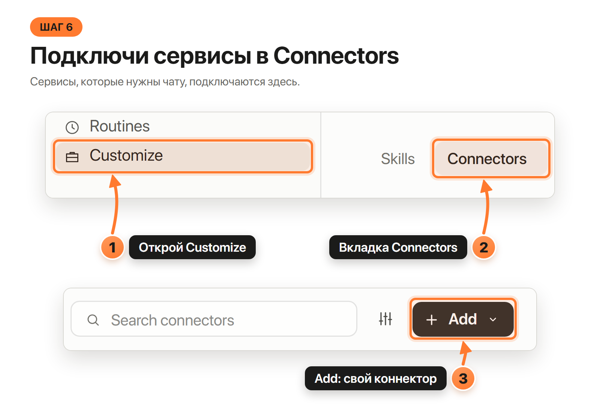

# Три чата в одной папке: как создать сессии в Claude Desktop

Нужны три чата: **Монтажёр** (он у тебя уже есть, туда ты отдал ссылку), **Скриптолог** и **Instagram-автоматизатор**. Все три работают в одной папке и передают друг другу файлы.

**Если Монтажёр показал карточки «Скриптолог» и «Instagram-автоматизатор», этот гайд не нужен: просто нажми на каждую карточку.** Он нужен, когда карточек нет (старая версия приложения, другой агент) или ты хочешь сделать всё сам.

Картинки нарисованы по окну Claude Desktop. В твоей версии надписи могут чуть отличаться: ориентируйся на значки и порядок кнопок. Как поставить приложение и войти: [claude-desktop.md](claude-desktop.md).

## Что нужно знать до начала

- Папка у всех трёх чатов **одна и та же**: та, куда агент склонировал репозиторий (в ней лежит файл `CLAUDE.md`). Если он клонировал в подпапку `kontent-zavod`, выбирай именно её.
- Роль чата задаёт **первое сообщение**. Название чата ни на что не влияет.
- Тексты первых сообщений лежат в папке `team/prompts/`: `scriptolog.md` для Скриптолога и `automator.md` для Instagram-автоматизатора.

## Шаг 1. Вкладка Code и кнопка New

1. В Claude Desktop нажми переключатель **Code** вверху слева (рядом переключатель **Chat**).
2. В боковой панели нажми **New**. Откроется пустой новый чат. На Windows то же делает `Ctrl+N`.

## Шаг 2. Выбери папку проекта

1. Над полем ввода нажми на название папки.
2. В списке **Recent** выбери папку проекта (например «Мой контент-завод»).
3. Если её в списке нет, нажми **Open folder…** и в окне Windows выбери папку. Это нужно сделать один раз, потом она появится в списке.

Для второго и третьего чата выбирай **ту же** папку, не новую.

## Шаг 3. Сними галочку worktree

Рядом с названием ветки (`main`) есть галочка **worktree**. Она делает для чата отдельную копию проекта. Нам это не нужно, потому что копия берёт только файлы, которые уже записаны в git.
Твой профиль `work/_profile/` и сценарии `work/<ролик>/SCRIPT.md` в неё не попадут, и чаты перестанут видеть друг друга.

**Сними галочку.** Если пункта worktree на экране нет, ничего делать не нужно.

## Шаг 4. Вставь первое сообщение роли

1. Открой в проекте файл `team/prompts/scriptolog.md` (для Скриптолога) или `team/prompts/automator.md` (для Instagram-автоматизатора) и скопируй весь текст.
2. Вставь его в поле ввода нового чата и нажми **Enter**.
3. Чат прочитает свой навык и начнёт с раздела 1.

Повтори шаги 1–4 для второго чата.

## Шаг 5. Проверь, что три чата в одной папке

В боковой панели под названием папки видны три чата. Порядок и названия у тебя могут быть другими. Главное, что все три лежат под одной папкой.

Закончил один чат, напиши в следующий: «готово, смотри work/<название ролика>/…». Файлы лежат в папке проекта, так чаты передают друг другу сценарий и пакет на выкладку.

## Шаг 6. Подключи сервисы (Connectors)

Так Claude получает доступ к твоим сервисам: почте, календарю, диску, Zernio.

1. В боковой панели нажми **Customize**.
2. Открой вкладку **Connectors**.
3. Нужный сервис из списка: нажми **+** на его карточке. Своего сервиса нет в списке: нажми **+ Add** справа вверху и выбери **Add custom connector**, впиши имя и адрес.
   Адрес Zernio и порядок подключения: [zernio.md](zernio.md), раздел 7. Работает ли такой коннектор именно во вкладке Code, документация прямо не говорит, это нужно проверить, поэтому в zernio.md есть запасной путь.
4. Для входа в сервис откроется браузер. Пароль и разрешения вводишь сам, агент их не вводит.

Ключи API (OpenAI, Telegram и другие) в чат не вставляются никогда. Правило одно для всех сервисов: [claude-desktop.md](claude-desktop.md), раздел «Куда положить ключ».

## Если что-то не так

| Что видишь | Что делать |
|---|---|
| Нет пункта worktree | Папка не git-репозиторий или агент ещё не склонировал проект. Ничего делать не нужно, продолжай |
| Чат не знает свою роль | Вставь первое сообщение из `team/prompts/` ещё раз, целиком |
| Скриптолог не видит профиль или Монтажёр не видит сценарий | Проверь, что у чата та же папка и галочка worktree снята. Лишний чат закрой и создай заново |
| Закрыл чат случайно | Открой новый в той же папке и вставь первое сообщение роли. Вся работа лежит в файлах, ничего не потеряно |
| Надписи на кнопках другие | Версии приложения отличаются. Сверься с [claude-desktop.md](claude-desktop.md) или спроси Монтажёра |

## Для Opus: какие композиции и кадры снять

Картинки `docs/guides/img/guide-01.png` … `guide-06.png` рисует код `src/guides/` (векторное окно Claude Desktop `claudeDesktop.tsx`, разметка `GuideShots.tsx`). В репозитории картинок пока нет, их нужно отрисовать.

- **Композиции:** `Guide-01` … `Guide-06` в студии, папка **Guides**. Это `Still` 1600×1100, один кадр каждая.
- **Команда:** `SCALE=1 node scripts/stills.mjs Guide-01 0` (кадр 0; по одному запуску на каждую из шести композиций). Результат: `out/stills/Guide-01-0000.png`.
  Скопировать как `docs/guides/img/guide-01.png`, и так для всех шести.
- **Что в каждом кадре:**
  1. `Guide-01`: фрагмент окна слева сверху, кольца на переключателе Code (1) и строке New (2).
  2. `Guide-02`: открытое меню папки, кольца на чипе папки (1), строке «Мой контент-завод» в Recent (2) и «Open folder…» (3).
  3. `Guide-03`: два фрагмента чипов, сверху «Так выглядит по умолчанию» (галочка стоит), снизу «Так должно быть» (галочки нет), кольцо на worktree.
  4. `Guide-04`: поле ввода с тремя строками первого сообщения, кольца на поле (1) и кнопке отправки (2).
  5. `Guide-05`: боковая панель, группа «Мой контент-завод» с тремя чатами, три кольца и подписи ролей справа.
  6. `Guide-06`: два фрагмента: сверху строка Customize в панели и вкладка Connectors, снизу кнопка «+ Add».
- **Что проверить глазами:** кольцо и стрелка не закрывают нужный текст окна; подписи не обрезаны краем кадра и не налезают друг на друга; текст в полях читается; нигде нет настоящих имён,
  в кадре только «Anna · Pro» и «Мой контент-завод»; в `Guide-04` три строки сообщения не вылезают из поля, чипы над полем не перекрыты.
  Сдвинулась геометрия: координаты шагов (`ring` в координатах окна, `badge` в координатах холста 1600×1100) правятся в `src/guides/GuideShots.tsx`.
- **Не сделано:** окно «Add custom connector» (окно есть в приложении, в коде его пока нет). Нужна `Guide-07`: допиши окно в `claudeDesktop.tsx` и добавь кадр в `src/guides/index.tsx`.
